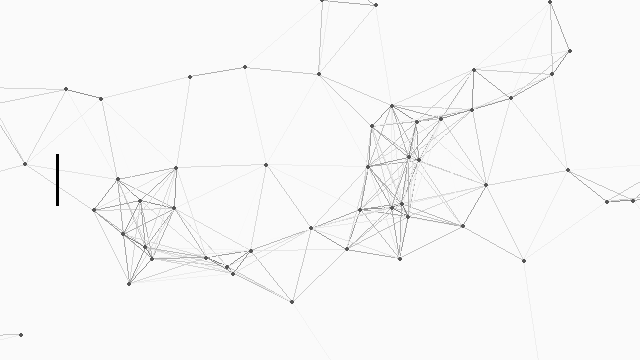

## Hey there! 👋

I'm a software engineer and developer with a passion for building accessible, reliable and innovate solutions.

## Work areas
- Development and design of scalable web platforms
- Deployment of conversational agents based on AI
- Construction of multi-platform mobile applications
- Implementation of computer vision for analysis and classification

## Tech Stack

### Languages

### Machine Learning & AI

### Backend

### Frontend

### Mobile

### Tools & DevOps

## Contact
- Portfolio: https://diegoalveal.com
- GitHub: https://github.com/DGVipe
- Email: dgvipedev@gmail.com
